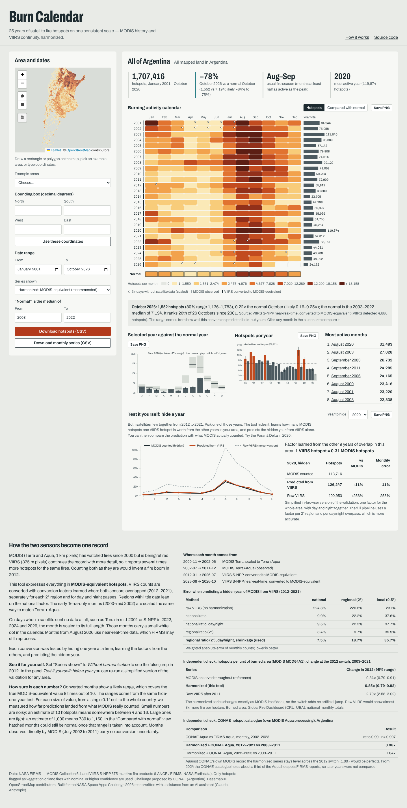

# Burn Calendar — harmonized MODIS + VIIRS fire hotspots

**NASA Space Apps Challenge 2026 · Harmonization of MODIS and VIIRS Hot Spots (challenge proposed by CONAE, Argentina)**

Burn Calendar turns 25 years of satellite fire hotspots into one consistent record and shows it as a
burning-activity calendar for any area you choose. Emergency managers, firefighters, scientists and land
managers can see which months of the year usually burn, which years were exceptional, and how the
current month compares with a normal one.

**Live app:** https://cucattigaston.github.io/burn-calendar/ · **Demo slides:** [docs/demo/burn-calendar-demo.pdf](docs/demo/burn-calendar-demo.pdf) · **Coverage:** Argentina, November 2000 → October 2026



## What you can do

- **Choose an area:** draw a rectangle or polygon on the map, pick an example area, or type a
  bounding box in decimal degrees.
- **Choose dates** and the years that define "normal". By default, normal is the 2003–2022 median for each
  calendar month.
- **Read the calendar:** years run down the rows and months across the columns, with an accessible ember
  colour ramp. Switch to *Compared with normal* to see each month as a ratio to the median of the same
  month, with teal for below normal and ember for above. A thin strip beside each year shows whether the
  month comes from MODIS or from converted VIIRS.
- **Get the key figures:**
  - total hotspots in the selected range;
  - the latest (or clicked) month against a normal month;
  - the usual fire season;
  - the most active year;
  - a ranking of the busiest months;
  - a chart of the selected year against the median year and the interquartile band;
  - hotspots per year.
- **Switch the series** between harmonized (the default), *without harmonization* (MODIS until 2011, then raw
  VIIRS), MODIS only and VIIRS only. The calendar, charts, figures and map all follow the choice, so the false
  2012 jump appears as soon as harmonization is switched off.
- **Test it yourself: hide a year.** Pick a year from 2012 to 2021. The app learns a MODIS ÷ VIIRS factor
  for your area from the other overlap years and predicts the hidden year from VIIRS. It then plots that
  prediction against what MODIS counted and against raw VIIRS, with the errors. This is a simplified version
  of the pipeline's validation: one factor per area, day and night together.
- **Download:**
  - the raw hotspots inside your area and dates (CSV, both sensors);
  - the harmonized monthly series (CSV, with source, ratio to normal and 80% ranges);
  - each chart (PNG).

## The harmonization

MODIS (Terra + Aqua, 1 km pixels, since 2000) is being retired. VIIRS (375 m pixels, since 2012) continues
the record but sees more and smaller fires, so it reports about **3.2× as many hotspots** as MODIS for the
same activity in Argentina. Adding them as they are would invent a fire boom in 2012.

Burn Calendar expresses every month in **MODIS-equivalent hotspots** (what Terra + Aqua would have
counted):

| Period | Source |
|---|---|
| Nov 2000 – Jun 2002 | MODIS Terra only, scaled to Terra + Aqua with regional day/night ratios learned in 2003–2011 |
| Jul 2002 – Dec 2011 | MODIS Terra + Aqua, observed |
| Jan 2012 – Jul 2026 | VIIRS S-NPP (standard processing), converted to MODIS-equivalent |
| Aug 2026 – Oct 2026 | VIIRS S-NPP near-real-time, converted to MODIS-equivalent |

**Conversion.** Hotspots are first cleaned. MODIS needs confidence ≥ 30 and VIIRS needs nominal or high
confidence; in both, only FIRMS `type = 0` (vegetation and land fires) is kept, which removes volcanoes,
static industrial sources and offshore detections. They are then counted on a 0.1° grid by month and by
day or night overpass. For each 2° region and overpass, a factor *k = MODIS / VIIRS* is learned over the
clean overlap years 2012–2021, chosen to avoid the Terra/Aqua orbit drift of the final mission years. The
factors are shrunk toward the national factor (prior weight 300 VIIRS hotspots), so regions with few fires
stay stable. National factors are 0.37 for day and 0.15 for night: VIIRS sees many small night fires that
MODIS misses.

**Satellite outages.** Sometimes a satellite delivered no data at all over Argentina for 3 or more days in
a row: Terra in mid-2001 and early 2002, and S-NPP in July–August 2022, mid-2024 and a few days of 2026.
For those months the harmonized value is scaled by *days in month ÷ days with data*. Single empty days (36
in total, mostly in winter and in the Terra-only years) are kept as real days without fire. Before this rule
they were scaled too; the change moves yearly totals by less than 1%. The calendar marks every month with 3 or
more missing days, and the tooltip says how many days were missing. January 2012, when VIIRS starts on the
20th, is handled the same way.

**Validation (leave one year out).** Each year from 2012 to 2021 was hidden in turn. The factors were
learned from the other nine years and used to predict the hidden year's MODIS counts from VIIRS. The table
shows the weighted absolute error of monthly counts:

| Method | National | Region (2°) | Local (0.5°) |
|---|---|---|---|
| Raw VIIRS (no harmonization) | 224.8 % | 226.5 % | 231.0 % |
| National ratio | 9.9 % | 22.2 % | 37.6 % |
| National ratio, day/night | 9.5 % | 22.3 % | 37.7 % |
| Regional ratio (2°) | 8.4 % | 19.7 % | 35.9 % |
| **Regional, day/night, shrinkage (used)** | **7.5 %** | **18.7 %** | **35.7 %** |

National bias after harmonization is below 1 %. Year by year, converted VIIRS stays within about ±10 % of
observed MODIS from 2012 to 2025 (`reports/yearly_sensor_comparison.csv`), with no jump at the switch.

**Uncertainty ranges.** Every converted number in the app comes with an 80% range, which is expected to
contain the true MODIS-equivalent value 8 times out of 10. The ranges come from the same leave-one-year-out
test. For each held-out year we compared what MODIS really counted with what the conversion predicted, at
five area sizes (0.1°, 0.5°, 1°, 2° and the whole country), for monthly values and for annual totals. The
pairs are pooled and binned by the size of the estimate, and the 10th–90th percentiles of observed ÷
estimated are taken in each bin. Ranges never widen as values grow.

| Monthly estimate | 80% range |
|---|---|
| 10 hotspots | 4–16 |
| 100 hotspots | 68–125 |
| 1,000 hotspots | 732–1,149 |

The Terra-only months (2000–02) get their own ranges from a leave-one-year-out test of the Terra → Terra +
Aqua scaling over 2003–2011. Months observed directly by MODIS carry no conversion uncertainty.

In the app:
- tooltips, the month detail and the headline figure show the range;
- the seasonal and annual charts draw it as whiskers;
- the monthly CSV adds `harmonized_low_80`, `harmonized_high_80`, `ratio_low_80` and `ratio_high_80`;
- in the *Compared with normal* view, a month is hatched when its range reaches the normal band (0.8–1.25×),
  meaning it could still be a normal month.

The ranges do not include sampling noise in the normal (median) itself, nor errors from the outage-day
scaling.

**Sensitivity analysis.** `pipeline/sensitivity.py` re-runs the hide-one-year test while changing one
choice at a time.

| Choice | Options tried | National monthly error |
|---|---|---|
| Calibration region size | 1° / **2° (used)** / 4° / national | 6.8% / **7.5%** / 7.9% / 9.5% |
| Pull toward the national factor | weight 0 to 3,000 (**300 used**) | 7.4%–7.6% |

- Neither choice moves the error by more than about one point, so the conclusions do not hinge on them.
  Smaller regions are marginally better, and ecoregions are a natural next step.
- The national factor drifts slightly over 2012–2021: −1.3% per year by day (95% range −2.2 to −0.3) and
  −2.1% by night (−3.8 to −0.4). This is consistent with MODIS ageing. A constant factor is therefore about
  6% off at the two ends of the period, which is inside the 80% ranges.

**Independent check against burned area.** If harmonization works, the number of hotspots per hectare
burned should not jump when the record switches from MODIS to VIIRS. We compared monthly hotspots with
national monthly burned area from MODIS MCD64A1 c6.1, taken from the Global Fire Dashboard (Climatic
Research Unit, UEA). The model, `pipeline/validate_burned_area.py`, is log(hotspots) ~ log(burned area) +
a 2012 step + month of year. Results for 2003–2021, when Terra + Aqua are complete and before orbit drift:

| Series | Change in hotspots per unit burned area at 2012 (95% range) |
|---|---|
| MODIS observed throughout (reference) | 0.84× (0.79–0.91) |
| **Harmonized** | **0.86× (0.79–0.92)** |
| Raw VIIRS after 2011 | 2.79× (2.58–3.02) |

The harmonized series changes practically as MODIS itself does (the 95% ranges overlap almost entirely). The modest decline after 2012 also shows up in
MODIS alone, so it reflects a real change in fires (or in the burned-area product), not an artifact of the
switch. Without harmonization the record would show almost 3× more fire per hectare from 2012. Over the
full 2001–mid-2023 window the harmonized step is 0.91×, against 1.04× for MODIS and 3.51× for raw VIIRS;
the gap comes from the Terra-only scaling of 2001–02 and MODIS drift in 2022–23. Monthly hotspots and burned
area have a log-correlation of 0.89 both before and after 2012.

**Independent check against CONAE's catalogue.** CONAE (Argentina's space agency) runs its own MODIS
processing chain on Aqua data received for Argentina. We downloaded its monthly totals by province (Aqua,
confidence ≥ 50) from the Catálogo de Focos de Calor, and compared them in `pipeline/validate_conae.py`.
- **Processing agreement.** CONAE Aqua vs FIRMS Aqua, 2002–2023: ratio of totals 0.99, monthly correlation
  0.997.
- **Continuity across the switch.** The ratio of harmonized to CONAE Aqua is 0.98× in 2012–2021 and 1.04×
  in 2022–2023, relative to the MODIS era (2003–2011). Raw VIIRS would be 3.14×. Monthly log-correlation for 2012–2023 is 0.986.
- **A finding for CONAE.** From 2024 the catalogue holds only 31% (2024) and 45% (2025) of the Aqua hotspots
  that FIRMS reports for Argentina, while FIRMS Aqua counts stay steady. This looks like a reception or
  processing gap in the catalogue, so years from 2024 were left out of the comparison.

**Comparison with published work.**
- Our national VIIRS-to-MODIS ratio is 3.2×: 2.7× for day passes and 6.7× for night passes. The literature
  explains this pattern.
  - Schroeder et al. (2014) found the 375 m product gives about 3× more daytime and 25× more nighttime fire
    pixels than VIIRS 750 m, because it detects small and cool fires, especially at night.
  - FIRMS states that the 375 m data respond better over small fires and perform better at night.
- Studies comparing VIIRS 375 m with Aqua MODIS find that VIIRS detections are close to a superset of MODIS.
  In Africa, VIIRS misses under 1% of daily Aqua MODIS detections at 0.25°, while MODIS misses many VIIRS
  detections. In Northeast Asia, 77% of VIIRS detections have no concurrent MODIS detection, and one case
  study found about 6× more VIIRS fire pixels. These findings support converting with a ratio.
- MODIS detection drops by about 67% from nadir to 60° view angle (Li et al., 2018). We do not correct scan
  angle explicitly; regional ratios learned over many overpasses absorb the average effect.

**Limitations.**
- Hotspots measure burning activity, not burned area.
- Cloud and smoke hide fires differently for each sensor.
- Error grows for very small areas, because monthly counts of a few hotspots are noisy for any sensor.
- Near-real-time months (August–October 2026) lack FIRMS' `type` flag. Instead, detections on ~1 km cells
  that the standard archive flagged as static sources are removed. Later reprocessing may change these
  months slightly.
- An outage-day correction assumes the missing days were as active as the rest of the month.
- **What hotspots cannot tell you.**
  - They measure activity, not burned area.
  - Clouds and smoke hide fires, and short fires between overpasses are missed.
  - Wildfires and agricultural or pasture burns are not separated.

  These points are also shown on the page.

## Run it yourself

```bash
pip install pandas numpy
# 1. Download FIRMS yearly country files for Argentina (MODIS C6.1 and VIIRS S-NPP) from
#    https://firms.modaps.eosdis.nasa.gov/country/ and combine them per sensor.
#    For the current year, use the FIRMS area API (free MAP_KEY) with VIIRS_SNPP_SP and
#    VIIRS_SNPP_NRT, then keep only points inside Argentina:
#    python pipeline/clip_to_country.py box.csv raw/viirs_snpp_SP_2026_ARG.csv.gz
# 2. Build the harmonized data used by the web app:
python pipeline/harmonize.py \
  --modis raw/firms_modis_ARG_2000_2025.csv.gz \
  --viirs raw/firms_viirs_snpp_ARG_2012_2025.csv.gz raw/viirs_snpp_SP_2026_ARG.csv.gz \
  --viirs-nrt raw/viirs_snpp_NRT_2026_ARG.csv.gz --until 2026-10 \
  --out web/data --reports reports
# 3. Serve the static site
cd web && python -m http.server 8000
```

The app is a static site with no server or build step:
- `web/data/grid.bin.gz` (≈3 MB) holds the harmonized 0.1° × month grid;
- `web/data/tiles/` holds the raw hotspots in 1° tiles for CSV export;
- `web/data/meta.json` holds the eras, factors and validation.

## Data and credits

- **NASA FIRMS** (Fire Information for Resource Management System, LANCE / NASA Earthdata):
  - MODIS Collection 6.1 active fire / thermal anomalies, 1 km (MCD14), DOI 10.5067/FIRMS/MODIS/MCD14ML;
  - VIIRS S-NPP 375 m active fire VNP14IMGT, standard and near-real-time, as distributed by FIRMS
    (DOI 10.5067/FIRMS/VIIRS/VNP14IMGT_NRT.002).
- **CONAE hotspot catalogue (validation only):** Catálogo de Focos de Calor, Comisión Nacional de
  Actividades Espaciales, https://catalogos5.conae.gov.ar/catalogofocos/ (registered access). Aqua monthly
  totals by province, confidence ≥ 50.
- **Burned area (validation only):** MODIS MCD64A1 c6.1 (Giglio et al., 2018), national monthly totals from the
  Global Fire Dashboard, Climatic Research Unit, University of East Anglia
  (https://climaticresearchunit.github.io/global-fire-dashboard/).
- **References:**
  - Schroeder, W., Oliva, P., Giglio, L., Csiszar, I. (2014). The New VIIRS 375 m active fire detection data
    product: Algorithm description and initial assessment. *Remote Sensing of Environment* 143, 85–96.
  - Li, F. et al. (2018). Comparison of fire radiative power estimates from VIIRS and MODIS observations.
    *Journal of Geophysical Research: Atmospheres* 123.
  - Biomass Burning in Africa: An Investigation of Fire Radiative Power Missed by MODIS Using the 375 m
    VIIRS Active Fire Product. *Remote Sensing* 12(10), 1561 (2020).
  - Fire Detection and Fire Radiative Power in Forests and Low-Biomass Lands in Northeast Asia: MODIS versus
    VIIRS Fire Products. *Remote Sensing* 12(18), 2870 (2020).
  - Giglio, L. et al. (2018). The Collection 6 MODIS burned area mapping algorithm and product. *Remote
    Sensing of Environment* 217, 72–85.
- **Challenge:** CONAE (Comisión Nacional de Actividades Espaciales, Argentina).
- **Boundary:** Argentina from Natural Earth 1:10m (public domain), via world-atlas. It agrees with 99.99%
  of FIRMS' own Argentina assignments for 2025.
- **Libraries:** D3 (ISC), Leaflet (BSD-2), Leaflet.draw (MIT), Archivo typeface (SIL OFL). All are bundled
  in `web/vendor`.
- **Basemap:** © OpenStreetMap contributors.

## Use of AI

This project was built with help from **Claude (Anthropic)**, an AI assistant. It was used to:
- help write and debug the Python pipeline and the web application code;
- compare harmonization methods;
- draft this README.

All code and text generated with AI assistance is marked as such in this README and in the file headers.
The data, validation numbers and figures come from running the code on NASA FIRMS data. No AI-generated
images are used.

## License

MIT (code). Data remain subject to NASA FIRMS terms of use.
